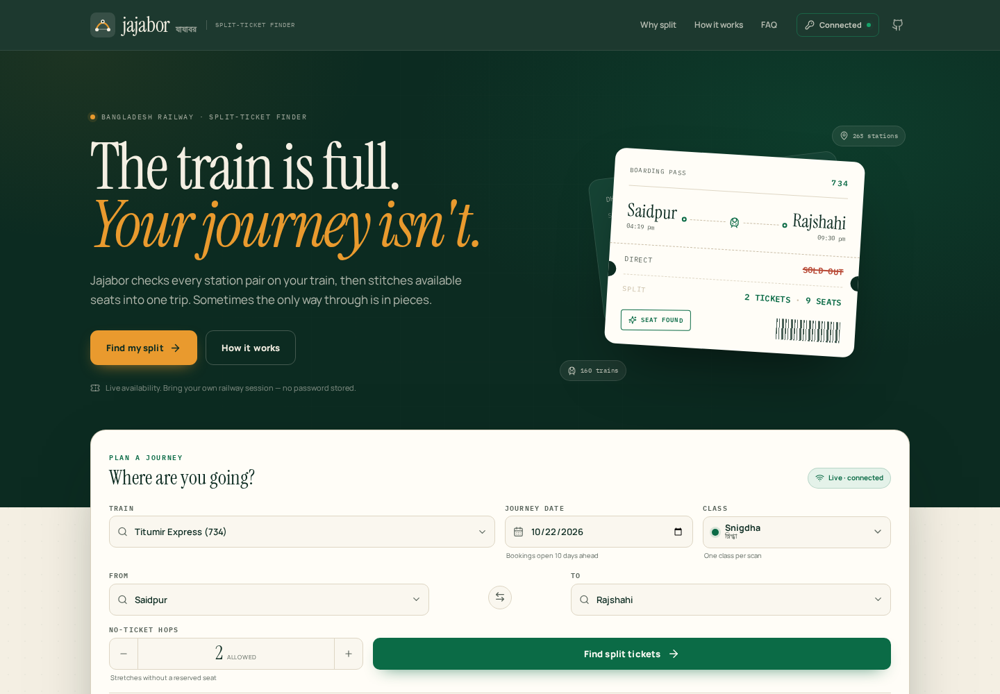
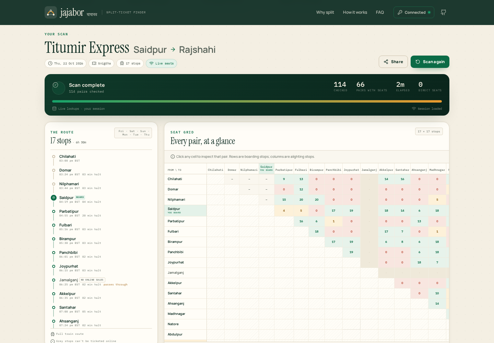
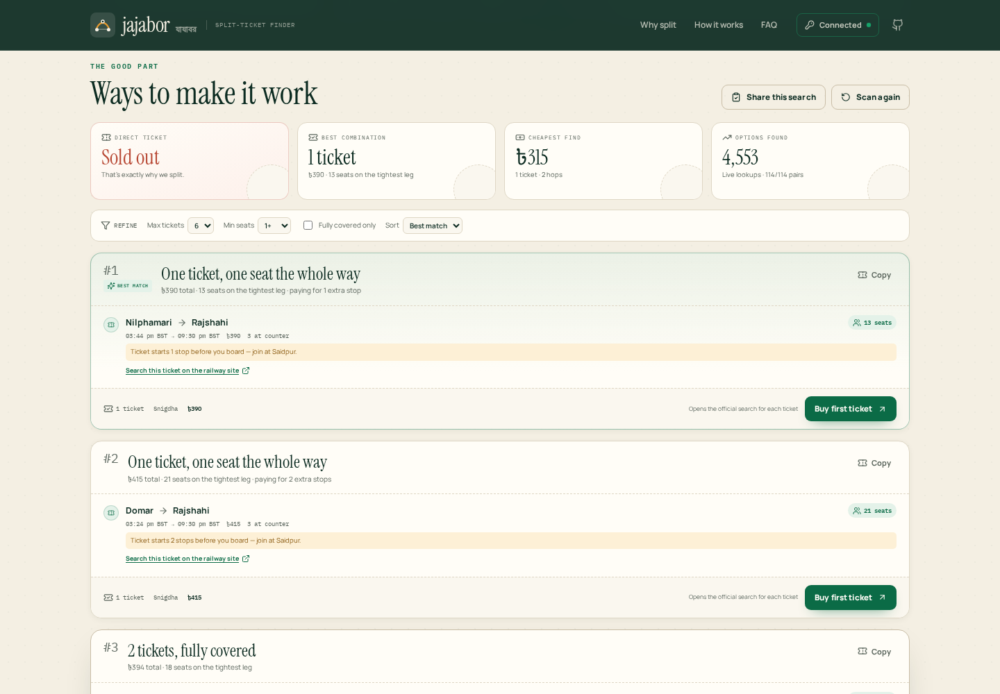
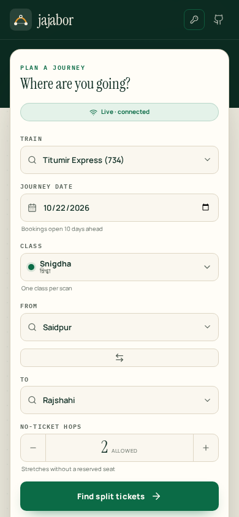

# Jajabor · যাযাবর

**The train is full. Your journey isn't.**

[](https://github.com/hello2himel/jajabor/actions/workflows/deploy.yml)
[](https://app.netlify.com/start/deploy?repository=https://github.com/hello2himel/jajabor)

Jajabor is a split-ticket finder for Bangladesh Railway. It checks every useful
station pair on a train, then stitches available seats into a journey — even
when the direct ticket is sold out.

This is a web GUI reimagining of
[TonmoyNaimur/split-ticket-finder](https://github.com/TonmoyNaimur/split-ticket-finder),
with real timetable data and live seat availability.



> Documentation screenshots use a test session with illustrative availability. The app itself
> always checks live data through your connected railway session.

## Why split tickets?

Railway seats are sold segment by segment. The direct Dhaka → Rajshahi seat can
be gone while the same train has space from Dhaka → Santahar and another seat
from Santahar → Rajshahi. Jajabor finds those overlaps and lays out the
trade-offs: number of tickets, seats on the tightest leg, fare, and any short
stretches without a reserved seat.

- **All-pairs availability** — checks boarding/alighting combinations around
  your trip, with an optional full-route matrix.
- **A real route finder** — depth-first search over available pairs, ranked by
  gaps, ticket count, extra distance, seats, and fare.
- **Three ways to search** — direct ticket, split tickets, or split tickets with
  a configurable number of unticketed hops.
- **See the whole train** — an interactive seat grid, route timeline, and
  detailed ticket breakdown.
- **Filters and sorting** — max tickets, minimum seats, fully covered only,
  cheapest, or most seats.
- **Shareable searches** — train, stations, date, class, and settings live in the
  URL.
- **Live availability** — uses your own railway session through a same-origin
  proxy: local Express or serverless Netlify Functions. No passwords, no OTPs,
  no analytics.



## Use Jajabor

**Hosted app:** <https://hello2himel.github.io/jajabor/>

Jajabor is live-only. It needs an active railway session and a proxy to fetch
seat availability. The hosted GitHub Pages build is static, so point it at a
local proxy or deploy the included Netlify functions.

Prefer your own deployment? Use the **Deploy to Netlify** button above; the
repository includes both the static frontend and the live serverless functions.

Seat counts are requested from the railway during a scan and change constantly.
The timetable itself is real: **160 trains**, **263 stations**, and the complete
stop list for every train, bundled as static JSON.

## Run locally

Requires **Node.js 20+**.

```bash
git clone https://github.com/hello2himel/jajabor.git
cd jajabor
npm install
npm run live
```

Open <http://localhost:8788>. This builds the frontend, starts the proxy, and
serves both from one origin. The timetable loads immediately; connect your
railway session to start scanning.

For development:

```bash
npm run dev
```

This starts Vite on <http://localhost:5173> and the proxy on port `8788`. Vite
forwards `/api` to the proxy.

### Ports

| Service | Default | Override |
| --- | --- | --- |
| Web + proxy (`npm run live`) | `8788` | `PORT=9000 npm start` |
| Vite dev server | `5173` | `npm run dev:web -- --port 5174` |
| Proxy used by Vite | `8788` | edit `vite.config.ts` |

## Live availability

The search API only accepts requests from its own web origin, so a browser on a
different domain can't call it directly. Jajabor ships two proxy backends that
forward your own session headers to the railway API:

- **Netlify Functions** — automatic when you deploy with the included
  `netlify.toml`. Requests go to `/api/*` on the same origin.
- **Local Express server** — used by `npm run live` and `npm run dev`.

Jajabor's code does not store tokens on disk or log them.

### 1. Start or deploy a proxy

Locally:

```bash
npm run live
```

Or, if you only need the proxy for a static build:

```bash
npm install
npm run build
npm start
```

On Netlify, deploy the repository with the included config. The four functions
in `netlify/functions/` are wired to `/api/health`, `/api/search`,
`/api/train-route`, and `/api/handshake` automatically. See
[Deploy on Netlify](#deploy-on-netlify).

### 2. Connect your session

1. Log in at <https://eticket.railway.gov.bd/>.
2. Open DevTools → Console and run the snippet shown in Jajabor's session modal.
   It reads your own `token`, `uudid`, and `ssdk` values from that site's
   `localStorage` and copies them as JSON.
3. Paste the bundle into **Session** in Jajabor, test the connection, and save.

Leave the proxy field **blank** when you opened Jajabor from
`http://localhost:8788` or from its Netlify deployment. Use
`http://localhost:8788` when the frontend is served from a static host such as
GitHub Pages, with the local proxy running separately.

The session is kept in `sessionStorage` by default and cleared when the tab
closes. Choose **Remember this session** to keep it in `localStorage`. Expired
tokens are rejected; reconnect when that happens.

### How the proxy is secured

**Local Express server**

- Binds to `127.0.0.1` by default.
- Validates station names, dates, and seat classes.
- 30-second upstream timeout and a 240-request/minute local rate limit.
- To use it from another origin, set `ALLOWED_ORIGINS` (comma-separated). By
  default it reflects the requesting origin, which is convenient for local use.
  Set an explicit list if you expose the proxy beyond your machine.

**Netlify Functions**

- Same-origin by default. Cross-origin callers are allowed only when their
  origin matches the deployment host or appears in `ALLOWED_ORIGINS`.
- Validates every request before it reaches the railway API.
- 8-second upstream timeout (override with `UPSTREAM_TIMEOUT_MS`) and an
  in-instance rate limit.
- Function responses use `Cache-Control: no-store`.
- Tokens are forwarded as request headers; Jajabor's code never writes them to
  disk or logs.

```bash
# Local proxy, explicitly allowing the hosted frontend
HOST=0.0.0.0 ALLOWED_ORIGINS=https://hello2himel.github.io npm start
```

> **A note on credentials:** a session token is a bearer credential. Only use a
> proxy deployment you trust. Jajabor's functions do not persist or log tokens,
> but they necessarily relay them to the railway API while a scan is running.
> Jajabor never asks for your railway password or OTP.

## How it works

1. **Pick a train and trip.** Routes and stops come from the bundled timetable
   data. Stops without online ticket sales are marked and skipped as endpoints.
2. **Choose which pairs to check.** Jajabor checks pairs that overlap the
   journey. Tickets may start before you board or end after you alight — you
   simply board and leave at your own stops. The full-matrix option checks every
   sellable pair.
3. **Ask for availability.** Jajabor calls the railway search API through the
   proxy, two requests at a time with a configurable pause.
4. **Stitch and rank.** A DFS combines available pairs, allowing up to the
   chosen number of unticketed hops. Results are ranked by gaps, tickets, extra
   distance, seats on the tightest leg, and fare.
5. **Book on the official site.** Each ticket links to the official railway
   search for that exact segment. Jajabor never buys or holds tickets.



On a phone, the seat grid and timeline scroll inside their cards, so the whole
page never runs sideways.



### Data and API notes

- Timetable snapshot: **October 2026**.
- Availability API: Shohoz's `search-trips-v2` endpoint, the same one used by the
  official e-ticket site.
- 12 route stops are not present in the station handshake (for example
  `Jamalganj`, `Kushtia`, `Goalanda_Ghat`). They are marked "no online ticket
  sales" and never used as ticket endpoints.
- Fare and seat counts come from the API response.
- Availability changes constantly. Always confirm on the official site before
  paying.

## Project structure

```
src/
  App.tsx                 state, scan orchestration, URL sync
  components/             search, workspace, matrix, results, modal, marketing
  lib/
    engine.ts             split-route DFS and pair selection
    scan.ts               live scan runner with progress and retries
    api.ts                railway API client and auth headers
    selection.ts          train/stop resolution
    format.ts             dates, times, fares
    session.ts            session parsing and token inspection
    cache.ts              short-lived client-side pair cache
public/data/              bundled trains, routes, stations
netlify.toml              Netlify build, redirects, cache and security headers
netlify/functions/        health, search, train-route, handshake functions
server/index.mjs          local Express proxy + static frontend server
server/netlify-upstream.mjs  shared proxy logic for Netlify Functions
docs/                     screenshots
```

## Scripts

| Command | What it does |
| --- | --- |
| `npm run dev` | Vite dev server + proxy |
| `npm run dev:web` | Vite dev server only (used by Netlify Dev) |
| `npm run build` | Typecheck and build to `dist/` |
| `npm run live` | Build, then serve web + proxy on `8788` |
| `npm start` | Serve an existing `dist/` + proxy |
| `npm run typecheck` | TypeScript only |
| `npm run preview` | Preview the built frontend (no proxy) |

## Deploy on Netlify

The repository is Netlify-ready. Click **Deploy to Netlify** above, or import
the GitHub repository in the Netlify dashboard, and accept the detected
settings. No manual build command or publish directory is needed.

`netlify.toml` is ready to use as-is:

- Builds with `npm run build` and publishes `dist/`.
- Deploys the functions in `netlify/functions/` on Node 22.
- Routes `/api/*` to the functions before the SPA fallback.
- Sets `VITE_PROXY_SAME_ORIGIN=true`, so Netlify builds use their own `/api`
  functions without a local proxy.
- Adds long-lived caching for hashed assets, short caching for timetable JSON,
  and standard security headers.

Optional Netlify environment variables:

| Variable | Purpose |
| --- | --- |
| `ALLOWED_ORIGINS` | Extra comma-separated origins allowed to call the functions |
| `RAILWAY_API_BASE` | Override the upstream API base |
| `UPSTREAM_TIMEOUT_MS` | Upstream timeout for functions (default `8000`) |
| `ALLOW_ANY_ORIGIN` | Set to `true` only if you intentionally want an open proxy |

Jajabor is live-only, so every visitor needs their own railway session. The
deployment's functions handle the proxy, so no local server is required.

To point another static frontend at these functions, paste the Netlify site's
origin into Jajabor's proxy field and add the frontend origin to
`ALLOWED_ORIGINS`.

To test the functions locally with Netlify's routing and redirects:

```bash
npx netlify-cli dev
```

The site is served on <http://localhost:8888>, with the functions behind `/api/*`.

## Deploying to GitHub Pages

The included GitHub Actions workflow builds with `BASE_PATH=/jajabor/` and
publishes `dist/` to GitHub Pages. That hosted build is static; live scanning
still requires a proxy. For Netlify, the serverless functions are included
automatically — see the Netlify configuration above.

To build for a different Pages path:

```bash
BASE_PATH=/your-repo/ npm run build
```

## Limitations

- Live scanning requires a proxy — Netlify Functions or the local Express server
  — and a valid railway session.
- The railway API is unofficial and can change without notice.
- A no-ticket hop means exactly that: no reserved seat for that stretch. Check
  local rules and availability before travelling.
- The route finder optimizes for a sensible combination, not a guaranteed
  seat. Availability can change while you book.
- This is not affiliated with Bangladesh Railway, Shohoz, or the original
  extension's author.

## Credits

- Original extension: [TonmoyNaimur/split-ticket-finder](https://github.com/TonmoyNaimur/split-ticket-finder)
- Timetable and availability data: Bangladesh Railway / Shohoz
- Typeface: Instrument Serif, Manrope, and IBM Plex Mono
- Icons: [Lucide](https://lucide.dev)

## License

MIT © 2026 hello2himel. See [LICENSE](LICENSE).
